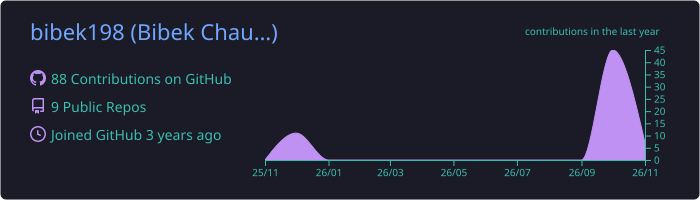
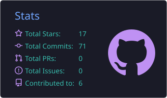
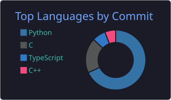

<p align="center">
  
</p>

<p align="center">
  <a href="https://git.io/typing-svg">
    
  </a>
</p>

<p align="center">
  <a href="https://www.linkedin.com/in/bibek-chaudhary/"></a>
  <a href="mailto:bibekchaudhary.tech@gmail.com"></a>
  <a href="https://github.com/bibek198"></a>
  
</p>

---

## 👨‍💻 About Me

```yaml
name: Bibek Chaudhary
education:
  degree: B.Tech, Electronics & Communication Engineering
  school: National Institute of Technology, Warangal
  years: 2023 – 2027
experience:
  - role: Machine Learning Intern @ ARSoft – VidyaWise
    work: Real-time multimodal voice AI — Pipecat, Triton, Faster-Whisper, RAG, streaming TTS
  - role: Technical Intern @ NatWest Group
    work: Fixed 60+ WCAG 2.2 AA accessibility issues in the Coutts Bank web app (Angular)
  - role: Agentic AI Engineer Intern @ Planetwise
    work: LLM-powered n8n automation pipelines — +200% qualified leads
currently_building: ComputeEdge — a C++ tensor engine for edge AI on Apple Metal
interests: [Systems Programming, ML Inference, Backend Engineering, Databases]
fun_facts:
  - National Rank 4, Nepal Physics Olympiad (NePHO 2023)
  - Represented Nepal at the International Chemistry Olympiad 2022 (China)
```

---

## 🚀 Featured Projects

<table>
  <tr>
    <td width="50%" valign="top">
      <h3>🫀 <a href="https://github.com/bibek198/biobridge-gateway">BioBridge Gateway</a></h3>
      <p>A <b>descriptor-driven gateway</b> for heterogeneous biomedical edge devices: <b>ESP32</b> firmware streaming ECG/PPG over USB-serial and BLE, a <b>zero-install browser gateway</b> (Web Serial / Web Bluetooth) with record and replay, multi-device clock sync, and verified declarative device drivers.</p>
      <p>
        
        
        
      </p>
    </td>
    <td width="50%" valign="top">
      <h3>🧠 <a href="https://github.com/bibek198/Vidur-the-secondary-brain">Vidur: the Secondary Brain</a></h3>
      <p>A <b>"company brain" agent</b> on <b>FalkorDB</b> that models the Kubernetes project as a company: SIGs are teams, KEPs are decisions, issues and PRs are the conversations, and OWNERS files are code ownership.</p>
      <p>
        
        
        
      </p>
    </td>
  </tr>
  <tr>
    <td width="50%" valign="top">
      <h3>⚡ <a href="https://github.com/bibek198/ComputeEdge">ComputeEdge</a></h3>
      <p>A lightweight <b>C++ tensor engine</b> for edge-AI workloads — tensor representations, matrix ops, a modular compute architecture, and <b>Apple Metal</b> GPU acceleration with CPU/GPU benchmarking on Apple Silicon.</p>
      <p>
        
        
        
      </p>
    </td>
    <td width="50%" valign="top">
      <h3>🗄️ <a href="https://github.com/bibek198/SQLMINT">SQLMINT</a></h3>
      <p>A <b>SQL database engine in C++</b> built from scratch — custom parser, schema manager and query execution pipeline supporting <code>CREATE</code>, <code>INSERT</code>, <code>SELECT</code>, <code>WHERE</code> and <code>DROP</code> on file-based storage.</p>
      <p>
        
        
        
      </p>
    </td>
  </tr>
  <tr>
    <td colspan="2" valign="top">
      <h3>🌾 Agriculture Trends & Optimal Climatic Conditions</h3>
      <p>ML pipeline forecasting crop yields from <b>35+ years</b> of district-level climate data using <b>ARIMA</b> in KNIME, with <b>Random Forest</b> to find optimal climatic parameters and propose district-wise agricultural zoning.</p>
      <p>
        
        
        
      </p>
    </td>
  </tr>
</table>

---

## 🧰 Tech Stack

**Languages**
<p align="left">
  &nbsp;
  &nbsp;
  &nbsp;
  &nbsp;
  &nbsp;
  
</p>

**Backend, Frameworks & Databases**
<p align="left">
  &nbsp;
  &nbsp;
  &nbsp;
  &nbsp;
  
</p>

**DevOps & Tools**
<p align="left">
  &nbsp;
  &nbsp;
  &nbsp;
  &nbsp;
  &nbsp;
  &nbsp;
  
</p>

**AI / ML**
<p align="left">
  
  
  
  
  
  
</p>

**Embedded & Edge**
<p align="left">
  
  
  
  
</p>

---

## 📈 GitHub Stats

<p align="center">
  
</p>
<p align="center">
  
  
</p>
<p align="center">
  
</p>

## 🐍 Contribution Snake

<picture>
  <source media="(prefers-color-scheme: dark)" srcset="https://raw.githubusercontent.com/bibek198/bibek198/output/github-snake-dark.svg"/>
  <source media="(prefers-color-scheme: light)" srcset="https://raw.githubusercontent.com/bibek198/bibek198/output/github-snake.svg"/>
  
</picture>

---

## 🏆 Achievements & Leadership

- 🥇 **NePHO 2023** — National Rank 4, National Physics Olympiad (Nepal Physical Society)
- 🌏 **IChO 2022** — Represented Nepal at the International Chemistry Olympiad, China
- 🎓 **Mahatma Gandhi Fellowship (2020)** — Awarded by the Indian Embassy
- 🤝 **Director, Talent Development** — 180 Degrees Consulting, NIT Warangal
- 🌱 **Executive Member** — National Service Scheme (NSS)

<p align="center">
  
</p>
